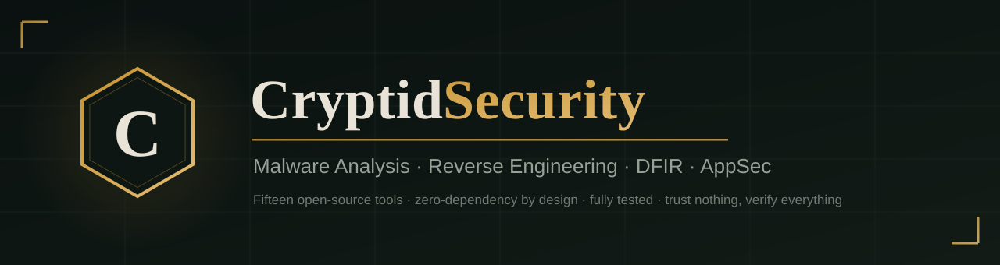

 

**Open-source defensive security tooling — malware analysis, reverse engineering, DFIR, and application security.**

 

---

## About

**Cryptid Security** builds small, auditable tools that do one job well — the kind of utilities an analyst actually reaches for during an incident. Every tool is written to run **offline**, with **no runtime dependencies** where the platform allows it, and ships with its **own test suite**. Nothing phones home, nothing is a black box, and every result can be reproduced by hand.

> **Trust nothing, verify everything.**

The toolkit spans the full defensive workflow — from pulling a config out of a live RAT, to walking process memory for injected code, to grading a domain's email anti-spoofing posture — and each piece is deliberately kept independent so it can drop into any pipeline.

---

## Malware Analysis & Reverse Engineering

| Tool | What it does |
|------|--------------|
| [**unmask**](https://github.com/njuj/unmask) | Config extractor for the AsyncRAT / DcRat / VenomRAT family — decrypts and HMAC-verifies the embedded settings (AES + PBKDF2). |
| [**kira-scan**](https://github.com/njuj/kira-scan) | PE triage with a **pure-Python YARA engine** — strings, conditions, and the `pe` / `math` / `hash` modules, no native deps. |
| [**ghost-hunter**](https://github.com/njuj/ghost-hunter) | Live memory scanner — finds injected and hollowed code by walking thread stacks and spotting private executable regions. |
| [**unwrap**](https://github.com/njuj/unwrap) | Dropper unpacker for `.lnk`, `.hta`, and HTML-smuggling containers — pulls the staged payload without executing it. |
| [**driver-guard**](https://github.com/njuj/driver-guard) | BYOVD analyzer — flags the vulnerable-driver capabilities (arbitrary R/W, process kill) attackers abuse. |

## DFIR & Threat Intelligence

| Tool | What it does |
|------|--------------|
| [**evtx-hunter**](https://github.com/njuj/evtx-hunter) | Windows Event Log hunter with its **own Sigma engine** — correlates bursts and decodes obfuscated PowerShell. |
| [**panoptes**](https://github.com/njuj/panoptes) | PCAP analyzer — detects RAT / Cobalt Strike certificates, DoH, and suspicious TLS by fingerprint. |
| [**ioc-hunter**](https://github.com/njuj/ioc-hunter) | Turns a threat report into clean, defanged IOCs and **STIX 2.1** bundles — 100% client-side. |

## Application & Supply-Chain Security

| Tool | What it does |
|------|--------------|
| [**headerguard**](https://github.com/njuj/headerguard) | HTTP security-header auditor and CSP generator — grades a site and hands back a ready policy. |
| [**mailguard**](https://github.com/njuj/mailguard) | Email anti-spoofing grader (SPF / DKIM / DMARC / MTA-STS) with a `--fix` that writes the records for you. |
| [**bundle-leak**](https://github.com/njuj/bundle-leak) | Scans deployed JS bundles and source maps for leaked secrets and recoverable source. |
| [**slopcheck**](https://github.com/njuj/slopcheck) | Dependency supply-chain risk — OSV advisories, typosquat detection, and secret scanning. |
| [**provenance**](https://github.com/njuj/provenance) | Verifies PyPI **PEP 740** attestations and checks for starjacking before you install. |

## AI & Content Security

| Tool | What it does |
|------|--------------|
| [**unseen**](https://github.com/njuj/unseen) | Reveals hidden text and prompt-injection payloads — zero-width characters, Unicode tricks, invisible PDF layers. |

## System Hardening

| Tool | What it does |
|------|--------------|
| [**harden-check**](https://github.com/njuj/harden-check) | Windows security-posture auditor — checks the controls that actually matter and tells you how to fix each gap. |

---

## Engineering principles

- **Zero-dependency by design** — standard library first. Fewer moving parts, a smaller attack surface, nothing to `pip install` on an air-gapped box.
- **Offline-first** — analysis never requires the network. What does reach out (advisory feeds, DNS) is explicit and optional.
- **Reproducible** — every result can be checked by hand. No magic, no hidden model, no telemetry.
- **Tested** — each tool ships with its own suite; a change that breaks behaviour breaks a test first.
- **One job each** — small tools that compose, not a monolith.

---

**Cryptid Security**

Defensive tooling for people who read the source.

